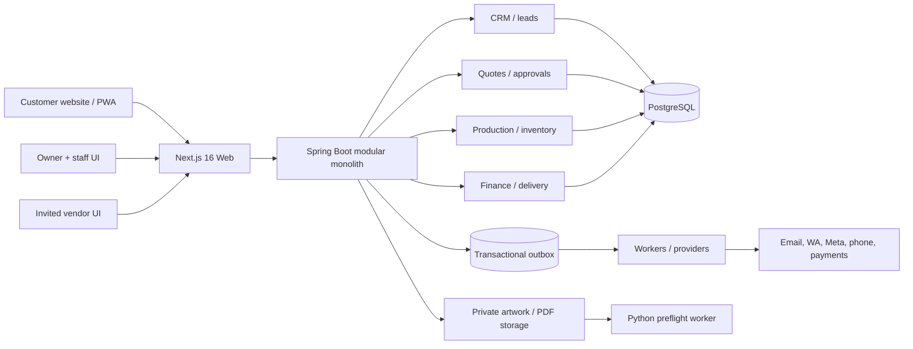
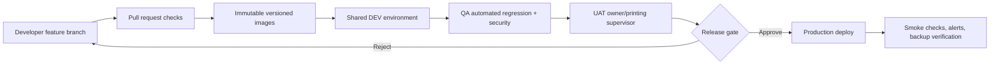

> Active implementation update (23 October 2026): the owner requested Gradle and native Windows development without Docker. Use `printflow application/CODEX_MASTER_PLAN.md`, `README.md` and `docs/STAFF_SLICE_VERIFICATION.md` for current commands and verified status. This root handbook is the original reference.

# PRINTFLOW STUDIO — MASTER CODEX DEVELOPMENT HANDBOOK

**Version:** 1.0 · **Date:** 23 October 2026 · **Project:** Offset Printing Company Operations Platform · **Phases:** 0–7

> **THE MAIN HANDOFF FILE.** Give this entire document and the zipped repository to Codex. Read this file first, then read `AGENTS.md`, `README.md`, `docs/SRS.md`, `docs/ARCHITECTURE.md`, `docs/FLOWCHARTS.md`, `docs/API_CONTRACT.md`, `docs/PHASE_BACKLOG.md`, `docs/ENVIRONMENTS.md`, `docs/INTEGRATIONS.md`, `docs/QA_TEST_PLAN.md` and `docs/SCREEN_MAP.md`, `docs/DISCOVERY_QUESTIONS.md`. Treat functional requirement IDs as traceability anchors. Do not start Phase 1 until the packaged Phase 0 compiles, runs and passes its acceptance checks.

---

## A. Product vision and success criteria

Build **PrintFlow Studio**: a professional two-sided (customer / owner) printing website with task-specific staff and external-vendor access. It covers the complete lifecycle: discovery and enquiry -> specifications -> estimation / negotiation -> proof version / sign-off -> advance and release -> press / finishing / QC -> invoice / shipment -> reconciliation, customer service and repeat order. Primary user is a single small-to-medium offset printing business serving local walk-ins and repeat B2B customers (India, Kolkata region initially), with many enquiries arriving offline, via phone, WhatsApp, email, Instagram or Facebook.

### Product principles

1. An **offline enquiry** is as important as an online order. Staff may create records on behalf of any customer.
2. Every order is one collaborative workspace with distinct **customer-visible**, **employee-internal**, and **vendor-limited** data.
3. Quote versions, artwork proofs and production jobs must preserve what was actually approved. Avoid silent overwrite.
4. The system must understand actual offset printing (paper yield, plates, machine configuration, time, waste, post-press), not treat every order as a generic retail cart.
5. Customer may not know GSM, duplex, spot colour or binding. Provide guided choices and a professional mode.
6. No AI-generated estimate may be accepted as authoritative without owner-controlled rates and human review.
7. Official provider integrations only, with opt-in, signatures, scopes, retries, message policy and provider costs.
8. Create a functioning **MVP after Phase 3** before advanced collaboration, social publishing, AI or SaaS work.
9. Prefer modular monolith and auditable relational data; no premature microservices.
10. Build small vertical slices with working migrations, APIs, UI, tests and docs on each iteration.

**Business KPIs:** enquiry-to-quote duration, quote-to-order conversion, proof turnaround, on-time delivery %, actual gross margin by job, stock wastage %, receivable ageing, repeat order %, owner/staff admin minutes per job, and communication response time. Define real baselines with the owner before claiming improvements.

---

## B. What is already built (Phase 0)

### Delivered code

- `frontend`: responsive Next.js App Router website, product cards, enquiry request page, secure enquiry tracking screen, **dev/QA-only** owner demo screen.
- `backend`: Java 21 / Spring Boot 4.1.1, catalog API, validated enquiry submission, 32-byte random tracking token whose SHA-256 digest is stored, public tracking via token header, status-event history, demo owner status updates.
- `backend/src/main/resources/db/migration`: Flyway migration that creates enquiries and events.
- `compose.yaml`: loopback-only web/API/PG Docker local stack, health-gated dependencies.
- `compose.qa.yaml`, `compose.prod.template.yaml`: examples / boundary documentation; **do not treat as production deployment**.
- `scripts/smoke.ps1` and `scripts/smoke.sh`: end-to-end API smoke checks.
- `.github/workflows/ci.yml`: backend/frontend static build/tests and Python repo validation.
- `docs/*`: requirement IDs, architecture, editable Mermaid diagrams, backlog, environment rules, API and test plans.

### Phase 0 deliberate limitations

There is **no real staff login**, authorization policy, file upload, payments, mail, WhatsApp, Facebook, Instagram or vendor portal in this starter. A guarded `/api/demo` exists only for local/QA demonstration. It is disabled when the Spring profile is `prod`. Public unauthenticated lead submission defaults disabled outside the explicitly configured local demo. **No Phase 0 public release with real customer information.** Technical builds were not run in the artifact-generation environment because package registries and Docker were unavailable: prioritize real build verification when opening in Codex.

### Run commands (Windows PowerShell)

```powershell
cd <path-to-extracted>/printflow-phase0
Copy-Item .env.example .env
docker compose up --build -d
docker compose ps
# open http://localhost:3000
./scripts/smoke.ps1
```

Local owner demo at `/business` uses `DEMO_ADMIN_KEY` in `.env`. Enquiry flow: public `/request-quote` -> backend PostgreSQL -> owner demo status change -> `/track` using ID and tracking token.

If Docker Desktop unavailable, start `docker compose up -d db`, then `mvn spring-boot:run` with env vars from README and `npm install && npm run dev` in separate terminals. Never assume Docker networking hostnames (`db` or `api`) work from a process started directly on Windows.

### FIRST CODEX TASK (blocking stability pass)

1. Inspect files and execute `docker compose config` and `docker compose up --build -d` on a network-connected machine.
2. Fix any real dependency, Java, TypeScript, Next.js or Docker build errors; do not conceal them by removing tests.
3. Generate and commit a `frontend/package-lock.json`; switch Docker/CI to `npm ci`, respecting current stable security patches without unintended major changes.
4. Run `mvn -B test`, frontend `npm run typecheck`, `npm run build`, `scripts/smoke.ps1`; review full logs.
5. Confirm PG Flyway migration, health endpoint, form submit and persistence after restart.
6. Verify demo routes inaccessible in prod profile; public intake disabled by default and tracking wrong-token denied.
7. Record actual versions and test output in `docs/PHASE0_VERIFICATION.md`, documenting any skipped checks or external dependency.
8. Add missing automated tests found during stabilization; ensure app remains loopback-only.
9. Present a Phase 0 completion report and **stop before Phase 1 unless explicitly approved**.

---

## C. Technology, layers and system boundaries

**Stack**: Next.js 16 + React 19 + TypeScript, Java 21 + Spring Boot 4.1, Spring Validation/JPA, PostgreSQL 17, Flyway, Docker Compose, GitHub Actions. Python worker for future PDF preflight, object storage compatible with S3, Redis only if needed, database outbox for notifications, server-sent events for simple live views, stronger MQ when operationally justified. Use shadcn/ui/Tailwind if beneficial after review; starter currently uses plain CSS to avoid unnecessary dependencies.

**Deployment target**: Java/Node containers, Linux runtime, Windows PowerShell development; four logical environments local, shared DEV, QA/UAT, PROD. Production requires HTTPS reverse proxy, private database, secrets manager, backup/PITR and monitoring. Production environment is **not provisioned** in this starter.

### Container diagram



### Domain model / aggregate roots

- `Customer`, `Organization`, `Membership`, `CustomerContact`, `Address`, `ConsentRecord`.
- `Enquiry`, `LeadActivity`, `LeadSource`, `Task`, `Communication`.
- `PrintProduct`, `PrintSpecification`, `PaperType`, `FinishingOption`, `MachineProfile`.
- `Quote`, `QuoteVersion`, `QuoteItem`, `PriceApproval`, `Acceptance`.
- `Order`, `OrderItem`, `ArtworkVersion`, `ProofApproval`.
- `ProductionJob`, `ProductionOperation`, `MachineAssignment`, `QCInspection`, `MaterialIssue`, `ProductionEvent`.
- `StockItem`, `StockBatch`, `Reservation`, `StockMovement`, `Supplier`, `PurchaseOrder`.
- `Vendor`, `VendorMembership`, `SubcontractWorkPackage`, `PartnerFileGrant`, `VendorDelivery`.
- `Invoice`, `LedgerEntry`, `Payment`, `Refund`, `CreditNote`, `Delivery`, `DeliveryAttempt`.
- `InboundProviderEvent`, `OutboundNotification`, `OutboxEvent`, `ProviderCredential`, `AuditEvent`.

Order and job are different objects: one order can produce multiple jobs and shipments; one job may contain multiple operations and outsourced stages. Avoid binding all activities to one simplistic `order_status`.

### Tracked state machines

- Lead: NEW -> REVIEWING -> QUOTED -> CONVERTED / LOST, or CLOSED.
- Quote: DRAFT -> SENT -> REVISION_REQUESTED / ACCEPTED / REJECTED / EXPIRED.
- Artwork: AWAITING -> UPLOADED -> PREFLIGHT -> PROOF_SENT -> CHANGES_REQUESTED / APPROVED.
- Commercial: CREATED -> AWAITING_PAYMENT -> RELEASED -> IN_PROGRESS -> FULFILLED -> CLOSED (with cancellation paths).
- Production operation: BLOCKED -> READY -> RUNNING -> PAUSED -> QC -> ACCEPTED / REWORK.
- Payment: UNPAID -> PARTIAL -> PAID, with refund ledger events independent of simple status.
- Delivery: PACKING -> READY -> DISPATCHED -> PARTIAL / DELIVERED / RETURNED.
- Vendor package: DRAFT -> INVITED -> ACCEPTED -> IN_PROGRESS -> RETURNED -> VERIFIED / REWORK / CANCELLED.

State transitions require transactional constraints, idempotency when needed, actor auth, audit and output projections. Source of truth in relational DB, not chat provider messages.

### Client UX

- Public pages: hero, service catalogue, company information, enquiry wizard, quote tracking, customer contact options.
- Customer: overview, quotes, order workspaces, proof annotations, messages, payment history, file library, delivery, reorder.
- Business: leads, quoting, order board, prepress, production planner, stock/procurement, finance, deliveries, inbox, reports, staff, settings.
- Worker: task/press queue, job tickets, material issue, start/pause/complete, defect/quality/quantity confirmations, QR.
- Vendor: invitations, accepted work packages, scoped files, status, deliverables, charges, no other access.

### Collaboration architecture

Each task/message/document is linked to `orderId`, `orderItemId`, `jobId` and/or `operationId`, plus `audience=INTERNAL|CUSTOMER|VENDOR` and a bounded ACL. A redacted vendor file pack is generated per work-package release and has expiring permissions. Customer messages should be threaded with related proof and quote revisions. External communications are linked by provider IDs and verified ownership, not copied into unrelated orders by a guessed phone or social username.

---

## D. Functional and non-functional requirement traceability

**Authoritative detailed functional requirements FR-001–071** are in `docs/SRS.md`. **Non-functional NFR-001–020** and proposed service objectives are in the same file. Never remove, renumber or silently downgrade existing requirement IDs; mark each as `TODO`, `IN_PROGRESS`, `IMPLEMENTED`, `VERIFIED`, `DEFERRED_WITH_REASON` in a requirements traceability matrix.

### Traceability file format (create in Phase 1)

`docs/REQUIREMENTS_TRACEABILITY.md` table columns: `ID | user story | phase | module | endpoints | UI screen | migration | tests | status | acceptance evidence`.

### Mandatory invariants

- Backend authorization at both role and resource/organization level; don't rely on frontend hiding.
- No vendor sees owner margin, final customer charge or another partner's package.
- No customer sees a different customer's names, address, notes, orders or documents.
- No tampering of accepted quote/spec/proof without new revision and sign-off.
- No job is released while approval/payment/material gates fail without authorized override event.
- No duplicated settlement on webhook retry; reconcile manual and gateway payments.
- No unexpected delete of inventory/finance/audit records; use reversal and audited corrections.
- Production file secrets never appear in web/public bucket or log.

---

## E. SDLC, repository conventions and release engineering

**Working branches**: `main` and short-lived `feature/PF-XXX-description`; PR review required. Do not use environment branches as a substitute for actual DEV/QA/PROD deployment infrastructure.

**Build verification**:

1. `python scripts/static_validate.py`
2. `cd backend && mvn -B test && mvn -B package -DskipTests`
3. `cd frontend && npm ci && npm run typecheck && npm run build` (after generated lock committed)
4. `docker compose up --build -d && scripts/smoke.ps1` from Windows PowerShell
5. Feature-specific security, integration, Playwright and k6 tests as introduced in later phases.

**Deployment sequence**: PR tests -> merge -> immutable images tagged by Git SHA -> DEV smoke -> QA integration/security/E2E -> UAT owner acceptance -> gated PROD -> post-deploy smoke/metrics -> rollback/forward-fix runbook. Run migrations safely with backward compatibility and backup; do not expect app image rollback to roll back destructive SQL.

**Release gates**: no P0 defects, unresolved high-risk security issues, inconsistent payment, lost customer approval or untested restore. Each milestone produces a demo, test evidence, screenshots, migration list and explicit owner acceptance.

**Environment safety**: never pass real credentials, customer PII or copyrighted customer artwork in examples, logs, GitHub issues, CI or AI prompts. Production must have secrets manager, private DB, TLS, sane headers, anti-bot protection, backups tested, audit trails, retention/consent and monitoring. Phase 0 is a local prototype.

### Working definition of done

- Feature uses approved story/ID and correct architecture boundary.
- Database migration includes rollback/forward-only operational considerations.
- Backend and UI enforce same required validations; backend remains authoritative.
- Authorization negative tests + meaningful unit/integration/E2E scenarios.
- Error/empty/loading states and accessible mobile layout.
- Audit/outbox/security/privacy requirements addressed where relevant.
- Documentation, test output and UAT evidence committed.

---

## F. Phase-by-phase instructions for Codex

### PHASE 0 — Foundation, runnable demonstration and verification (delivered starter)

**Goal:** Make the repository buildable, understandable and repeatable; finish documentation and environment scaffolding, not production features.

**Already authored:** Compose/Java/Next/PG, enquiry POST, owner demonstration statuses, tracking, schema migration, docs, smoke tests, ADRs, CI pipeline. **Must run verification on a machine with Docker/Maven/npm dependency network access.**

**Required Codex tasks**
1. Inspect build configs; run actual Docker/Java/Next builds; fix errors and regenerate lockfile.
2. Check database schema, JPA validation, Flyway applied on clean DB and restart.
3. Test create/status/track plus invalid token, missing key and prod-profile exclusion.
4. Add basic Playwright E2E and bootstrap product docs screenshots if tools installed.
5. Review security limitations and mark Phase 0 not production-ready.
6. Validate requirements with printing owner and record open assumptions in `docs/DISCOVERY_QUESTIONS.md`.
7. Produce verification report, no unverified claims.

**Exit:** local `docker compose up --build -d`, health status UP, homepage loads, enquiry saved to Postgres, owner advances status, tracking reflects it; tests green; QA/docs accurate; production blocked.

### PHASE 1 — Identity, CRM, print catalogue and secure workflow foundation

**Goal:** Replace prototype privileges with real users and build reliable lead handling. This is the critical production security phase.

**Features**
1. Real staff account and role system (owner, sales, estimator, designer, supervisor, operator, inventory, accounts, delivery); admin MFA; customer verified email/phone access; invited vendor role placeholder.
2. Session/CSRF strategy, secure password reset/OTP provider design, no hardcoded secret; application-level RBAC and ownership guards, negative cross-tenant object access tests.
3. Replace dev `/api/demo` routes with `/api/v1/staff/enquiries` under auth. Remove demo mode from public deployment/build path.
4. Lead CRUD, assignment, follow-up, source, contact search, duplicate suggestions and merge audit.
5. Staff-assisted enquiry for walk-in/call, no automatic claims of phone or social sync yet.
6. Company profile, addresses, contacts, user consent preferences; privacy notice and request rights design.
7. Configurable product catalogue: brochure/flyer, visiting card, book/catalogue, packaging/custom. Product specification templates and validations (size, paper, GSM, colour, pages, finish, delivery need).
8. Anonymous enquiry protective controls: rate limit, bot protection, CAPTCHA/alternative, abuse monitoring and input limits. Encrypt sensitive data, isolate file upload integration prep.
9. PWA/mobile navigation, employee dashboard, empty/error states, page-level access control backed by API enforcement.
10. New Flyway migrations, OpenAPI, Swagger docs behind auth where needed, CI and API contracts.

**UI screens:** `/customer/...`, `/business/leads`, `/business/customers`, `/business/settings/users`, `/products/[slug]`, quote wizard. Use `docs/SCREEN_MAP.md`.

**Tests:** authentication session invalidation, MFA paths, OTP replay, BOLA for all owner/customer/vendor access, anti-abuse, staff-assisted lead validation, availability under realistic load. Phase 1 external sign-off by company owner and privacy/security review.

**Exit:** Secure, staff-operated CRM and product enquiry system. No publicly accessible prototype demo keys. Backups and consent/retention for actual data ready before commercial pilot.

**Codex execution prompt:**
> You are implementing Phase 1 of PrintFlow Studio. Read `CODEX_MASTER_PLAN.md`, `docs/SRS.md`, `docs/ARCHITECTURE.md` and `docs/SCREEN_MAP.md`. Preserve the runnable Phase 0 starter. First verify test/build, then create a requirement-to-implementation plan for FR-001–013 and FR-062. Replace the demonstration owner endpoint with production-grade authentication/RBAC; implement staff-assisted enquiries, CRM and print-product configuration as vertical slices. Build database migrations, typed endpoints, customer/staff UI, negative authorization tests, Playwright E2E, and Dev/QA setup. Do not enable real social, payment or auto-pricing yet. Show diffs, tests run, unverified blockers and updated traceability. Stop when Phase 1 acceptance gate passes.

### PHASE 2 — Quotes, negotiation, artwork versioning and order conversion

**Goal:** Move an enquiry into a legally and operationally traceable order without manually re-entering data.

**Features**
1. Quote/quote-item and immutable quote-version SQL models; taxes, discounts, delivery and payment terms, validity/expiry; staff-defined manual pricing, owner approval thresholds.
2. Quote v1 -> sent -> revision requested -> v2 -> accepted or rejected. Accept records version, customer, time, price, units and terms checksum; expiry policy and cancellation.
3. Branded PDF quote and order confirmation. PDFs generated server-side and stored securely.
4. Secure artwork ingestion, private storage, antivirus/isolation, file checksums, version metadata; optional customer prepress request.
5. Proof sharing via expiring authenticated links, approve/comment/request changes; approval tied to exact file hash/specification and user identity. PDF annotations may be P1 after basic proof.
6. Conversion accepted quote -> order/item(s), snapshot of price, quantity, specs and artwork approval status. Transaction and outbox event on conversion.
7. Order workspace for customer and owner including quotation, specification, file versions, messages, timeline, internal-only activities.

**Tests:** quote cannot be modified after acceptance; out-of-date quote approval returns clear conflict; files inaccessible across customers; replacing approved artwork blocks release; PDF document amounts reconcile with DB; race on simultaneous acceptance.

**Exit:** real customer and staff accept a quote and proof; the resulting order preserves exact commercial and artwork evidence.

**Codex execution prompt:**
> Implement Phase 2 of PrintFlow Studio using the authoritative SRS and ADRs. Build FR-008–016, FR-024–028, linked with Phase 1 identities. Define immutable QuoteVersion, Order, OrderItem, ArtworkVersion, ProofApproval aggregates and state transition rules; private file storage with scanning; branded PDF documents; customer acceptance and proof flows. Build the corresponding portal screens, Flyway migrations, OpenAPI, unit/integration/E2E and authorization negatives. Display provisional/manual pricing honestly. Do not implement full automated press estimating yet. Provide a completed enquiry-to-order demonstration and update docs before declaring done.

### PHASE 3 — Production, QC, invoice, balance and delivery — first operational MVP

**Goal:** Fulfill a real pilot order entirely through the application after authorised approvals.

**Features**
1. Configurable route templates per product, jobs per item, operations with dependencies and assignees.
2. Staff workboard / worker mobile mode: assigned tasks, ready/blocked, start/pause/finish, production quantity, downtime/issue notes, audit.
3. Basic stock item list and tracked manual issue, stock movements. Full reservations later.
4. Production release gates for quote/proof and accounts advance/credit; owner override audited.
5. Quality inspection and rework path, quantity produced, rejected, usable, fulfilled.
6. Invoice and receipt based on accepted quote/order, basic taxes configured with accountant, manual payment log and balance; no online gateway yet.
7. Packing, pickup/dispatch, proof-of-delivery; customer shows accurate stage milestones, without leaking internal manufacturing notes.
8. Simple owner dashboard of new enquiries, pending approvals, active/late jobs, ready-to-dispatch, outstanding balance.

**Tests:** cannot release missing proof, splits/rework do not inflate completed quantity, expected invoice and outstanding balance, staff role isolation, partial delivery, concurrency on stage updates, printable job ticket and mobile UI.

**Exit:** owner supervises one complete order through enquiry, quote, proof, production, QC, invoice, manual payment and delivery. Pilot with actual realistic jobs **only after security/privacy and infrastructure approval**.

**Codex execution prompt:**
> Implement Phase 3 production and fulfillment MVP. Read entire development plan. Create ProductionJob, ProductionOperation, audit events, basic material movements, inspection, Invoice, manual Payment and Delivery. Wire approved OrderItem to guarded production release and staff assignments, mobile shop-floor statuses, QC and dispatch. Keep customer status separate from internal work details. Validate an entire end-to-end demo and negative transitions, transactions, money calculations, access and restores. Document readiness and test evidence. Stop before adding payment provider/social/AI integrations.

### PHASE 4 — Real-world communication, WhatsApp, social leads, email and gateway payments

**Goal:** Turn the internal operating system into a communication hub for local customers.

**Integration foundation**
1. Database outbox + inbox with provider_event_id dedupe, signature validation, retry/backoff, dead-letter, observability, provider-specific configuration and credential encryption.
2. CRM contact matching by verified identifiers and confidence, disambiguation queue; never auto-merge two humans because names resemble each other.
3. Consent and template restrictions per channel; message delivery state and opt-out tracking.

**Provider-specific**
- **WhatsApp:** Official Meta Cloud API / approved BSP; inbound messages, permitted replies, approved templates outside service window, delivery webhooks, proof/quote/payment links; no web scraping.
- **Email:** Gmail/Microsoft OAuth if using mailbox sync or provider/SMTP send-only if preferred; threads and attachments, virus scan, staff-approved sending.
- **Meta Facebook and Instagram:** supported business inbox features under approved scopes; Meta Lead Ads webhook with source attribution, token lifecycle and page/professional account requirements. Manual fallback if API permission unavailable.
- **Payments:** authorized Indian provider payment links/checkout, signed webhooks, idempotent transactions, reconciliation, refund flows; never mark paid from redirect.
- **SMS:** approved transactional/OTP route under local Indian requirements.
- **Phone:** manual call logs now; later supported telephony with explicit provider consent/rules.

**Tests:** duplicate webhook, out-of-order delivery, revoked token, provider timeout, fraud signature, customer opt-out, money round-off/refund, identity mismatch and attachment attacks. Tests use sandboxes and fake data.

**Exit:** initial real channels are configured only after business credentials and provider approval; queries/messages trace to correct enquiry/order and failure does not block print work.

**Codex execution prompt:**
> Implement Phase 4 as provider adapters over normalized inbound and outbound events. Start with persistent outbox/inbox, verified webhooks, replay/idempotency, consent and staff review. Integrate selected live providers one at a time in sandboxes: email, official WhatsApp, approved Meta Lead Ads/Messenger/Instagram features, and an Indian payment provider. Do not claim API privileges without verifying actual account scopes. Never scrape WhatsApp Web or Google Business Messages. Preserve a fully functional manual fallback. Include cost/permission notes, monitoring and negative tests. Release behind feature flags after UAT.

### PHASE 5 — Vendor work sharing, procurement, production scheduling and advanced stock

**Goal:** Support internal-external work collaboration without exposing confidential commercial data.

**Features**
1. `SubcontractWorkPackage`: selective operation(s), instructions, quantities, materials sent, required files, vendor price, due date, QCs, return records.
2. Vendor invite/accept workflow with scoped role and expiring file grants. Confidentiality limits enforced by query-level and serializer tests.
3. Suppliers, purchase requests/POs, goods receipt, stock batches, reservations with concurrency protection, reorder alerts, wastage.
4. Machine capability registry, shift calendar, production scheduler, allocation conflict resolution, manual owner override.
5. Operator QR job tickets, mobile time and machine input, real-time status via server-sent events as required.
6. Local delivery enhancements, partial shipments, own-driver proof vs optional courier integration.
7. Internal task templates, dependencies, mentions, cross-team handovers and vendor messages.

**Tests:** vendor A != vendor B scope, no sell-price leakage, revoked file inaccessible, stock reservation concurrency, rework on rejected subcontract, machine overbooking rejected, partial shipment and material reconciliation.

**Exit:** a job can be part printed in-house, part outsourced, returned, quality checked, inventoried and delivered from one workspace.

**Codex execution prompt:**
> Implement Phase 5 based on PF-500..PF-520 and FR-038..044, FR-050..052, FR-055, FR-066..067. Build supplier/vendor permission isolation, redacted subcontract work packages, stock reservations with concurrency tests, material transfer ledgers, machine calendars, task dependency boards, QR operation updates and partial delivery flows. Prove multi-vendor security isolation and end-to-end outsourced job acceptance; update APIs, UI and QA/UAT evidence.

### PHASE 6 — Offset print estimating, PDF preflight and analytics

**Goal:** Make PrintFlow a real print MIS by modeling physical costs and work.

**Offset calculation requirements**
- Print product size and parent sheet, grain, gripper/non-image margins, plate size, imposition, yield and signatures for books.
- Duplex methods, 1/0, 1/1, 4/0, 4/4, spot plates, ink/click model, setup and makeready waste.
- Plate prep, proofing, press setup/run speeds, work shifts, outsourced finishing, cutting/folding/binding/die, lamination, wastage, transport, tax.
- Actual supplier/material rates, spoilage rules, overhead, credit/discount, target contribution/gross margin and rounded quote outputs.
- Quote multiple quantities/material alternatives; explain why price changes; no guess hidden in totals.

**PDF worker**: isolated sandbox with limits on CPU, memory, page count and size, scan first, validate page/bleed/fonts/resolution/colour, thumbnails and checksums, capture confidence/uncertainty. PDF/X support and monitor colour limitations documented. Never modify approved source automatically.

**Analytics**: estimate vs actual margins, material waste, production throughput, recurring customer revenue, receivables, overdue operations, quotations conversion, campaigns and vendor performance.

**Tests:** benchmark rate calculations against **at least 20 manually costed historical sample jobs** spanning brochures, cards, booklets and packaging; owner/estimator approves rule results and tolerances. Malicious PDF fixture, oversized input, wrong font/bleed and CMYK variants tested. SQL report totals reconciled with ledger.

**Exit:** estimator trusts controlled print estimates under explicit known constraints; analytics reconciled; preflight flags production risks without false approval claims.

**Codex execution prompt:**
> Implement Phase 6 offset estimating and artwork preflight. First obtain real paper sizes, press capabilities, vendor rates and at least 20 sample historical jobs. Define deterministic yield/plates/press/finishing/transport/tax pricing rules with explainable breakdowns and no hard-coded real prices. Add configurable price books, estimate-vs-actual margin, quantity alternatives and validation suites. Build isolated Python PDF preflight worker with scanning, timeouts and technical warnings. Reconcile reports. Require human estimator sign-off and tests before enabling automatic quote suggestions.

### PHASE 7 — Assisted intelligence, marketing and optional SaaS research

**Goal:** Enhance proven operational workflows, not substitute for them.

**Candidates**
- AI parses supported inbound text, suggests product spec, flags missing details; human confirms lead/quote.
- Explainable quote optimization/batching without silently changing owner-approved specification.
- Capacity/delivery-date prediction from operation durations, inventory and dependencies with uncertainty bands.
- Repeat-order suggestions and account recommendations respectful of consent and messaging policies.
- Approved social content scheduling/publishing subject to platform permissions; referral and campaign conversion analytics.
- If product-market fit warrants: explore data isolation and billing architecture for independent print businesses before writing multi-tenant code.

**Tests:** AI prompt injection from customer uploads, invented specs/costs, confidential data exfiltration, safety/evaluation set, manual override, performance measured against actual baseline and privacy/consent.

**Exit:** measurable benefit with a reject/override path, feature toggles and compliance review.

**Codex execution prompt:**
> Evaluate and implement a limited Phase 7 assistive feature only when earlier phases and baselines are stable. Use synthetic or approved data, human confirmation, documented AI failure modes and metrics. Prioritize explainable, auditable suggestions; never auto-send prices, confirm printed colour or change a production job without authorization. Implement feature flag, regression tests, evaluation dataset, UX explanation and rollback before release. SaaS tenant isolation remains a separate architecture decision.

---

## G. Integration and collaboration requirements

Refer to `docs/INTEGRATIONS.md` for details. The guiding pattern is **source -> verified webhook/listener -> canonical event -> lead/contact resolution -> linked Order Workspace -> assigned human -> approved response via outbox**. Webhooks do not directly mutate final business records without validation.

### Contact/channel tracking

Required lead fields: source channel, provider account, provider event/conversation IDs, campaign ID if applicable, external contact identifiers, verification status, opt-in, first contact, last contact, staff owner and follow-up due. Default ambiguous matches to **new unverified lead**, not merged contact. Subject to permissions from Meta, Gmail, WhatsApp, phone provider and payment gateway.

### Work-sharing visibility matrix

| Item | Customer | Owner/authorized staff | Vendor |
|---|---|---|---|
| Product specification | Own only | Assigned/authorized | Work-package subset |
| Sell price, discounts, credit | Own only | Authorized sales/accounts/owner | Never |
| Internal cost, margin | Never | Restricted estimator/owner/accounts | Never |
| Internal notes | Never | Assigned employees | Never |
| Quote/proof approval | Own only | Authorized | Proof subset only if needed |
| Printing files | Own only | Assigned/prepress | Explicitly shared work file only |
| Vendor purchase price | Never | Purchasing/accounts/owner | Own vendor assignment only |
| Machine schedule | Customer summary only | Relevant operations | Vendor due date only |
| Delivery details | Own | Logistics/accounts | Only if directly necessary |

---

## H. API conventions and contracts

Current working Phase 0 endpoints: see `docs/API_CONTRACT.md` for exact JSON and response codes.

Future protected API segments:

```text
/api/v1/auth/**
/api/v1/public/catalog/**
/api/v1/public/enquiries/**
/api/v1/customer/orders/**
/api/v1/customer/quotes/**
/api/v1/business/customers/**
/api/v1/business/enquiries/**
/api/v1/business/quotes/**
/api/v1/business/orders/**
/api/v1/business/production/**
/api/v1/business/inventory/**
/api/v1/business/finance/**
/api/v1/business/collaboration/**
/api/v1/vendor/work-packages/**
/api/v1/webhooks/{provider}
```

Cross-cutting requirements: request/response IDs, pagination, validation errors, auth/ownership, idempotency for create/payment, OpenAPI specs, strict date/time handling, no leaked stack traces. File upload uses pre-signed scoped URLs and private storage rather than public static hosting. Use deterministic API tests.

---

## I. Dev, QA, Production delivery and rollback

Phase 0 local compose is loopback-only, not a production image service. QA/prod templates are environment **design**; real QA/production need separate hosts, domains, secrets, and secured services.



### Technical DevOps backlog

- Replace dependency install with lockfile-controlled builds in first PR; pin runtime images and automate patch cadence.
- Add PR test workflow for backend, frontend, SAST/secrets/dependency scans; verify no credentials in repo.
- GitHub actions environments, branch protection and release approvals (check plan availability).
- Implement database migration strategy with migration tests + rollback/forward-fix plan.
- Create actual cloud production IaC once host/provider chosen; private DB and object storage, HTTPS, secret manager, backups, monitoring and logs.
- Use masked synthetic QA data; never clone real DB into publicly reachable QA.
- Establish RPO/RTO in restore drills, not by document assertion.

---

## J. Acceptance matrix and QA plan

See `docs/QA_TEST_PLAN.md` for scripts, scenarios and release criteria. Every phase adds contract tests, negative permission tests and Playwright user journeys; high-impact tasks should have integration tests against PostgreSQL Testcontainers rather than mocks alone.

### Minimum end-to-end operational UAT (post Phase 3)

1. Local caller requests 5,000 brochures; employee creates enquiry with source PHONE and due date.
2. Estimator issues two quote versions for different paper GSM; customer accepts v2; v1 remains in history.
3. Customer uploads PDF, designer reviews and issues proof v3, customer signs v3. Later alteration requires reapproval.
4. Customer pays agreed advance/authorized credit. Manager releases job only when gates pass.
5. Job contains plate preparation, press, lamination, cutting, packing. Assign machine/operator, record output and waste, QC.
6. Outsourcing vendor performs lamination in Phase 5 and sees only scoped vendor data.
7. Invoice and remaining balance reconcile; partial dispatch supported with proof of delivery.
8. Customer portal shows understandable timeline, downloads own invoice/proof; cannot access other account's records.
9. Delayed message provider doesn't undo order; outbox catches up later (Phase 4).
10. Owner checks true job profitability and repeat order history (Phase 6).

### Non-functional test workload proposal

Reference starting point: 50 employees, 500 active customers, 1,000 orders/month; p95 user interaction <= 2 seconds, normal read API p95 <= 500 ms under agreed workload, 99.5% monthly availability goal, RPO <= 1 hour and RTO <= 4 hours. These are **proposed**, require actual capacity/hosting validation. Never claim performance without k6 load evidence or restore targets without drill evidence.

---

## K. Phase 0 source layout

```text
printflow-phase0/
├── README.md
├── AGENTS.md
├── CODEX_MASTER_PLAN.md            <-- MAIN CODEX HANDOFF
├── .env.example
├── .env.qa.example
├── .env.prod.example
├── compose.yaml
├── compose.qa.yaml
├── compose.prod.template.yaml
├── frontend/
│   ├── Dockerfile
│   ├── next.config.mjs
│   ├── package.json
│   └── src/
│       ├── app/{page.tsx,request-quote,track,business}
│       ├── components/
│       └── lib/api.ts
├── backend/
│   ├── Dockerfile
│   ├── pom.xml
│   ├── src/main/java/com/printflow/{catalog,enquiry,shared}
│   ├── src/main/resources/application.yml
│   ├── src/main/resources/db/migration/V1__create_enquiries.sql
│   └── src/test/java/com/printflow/enquiry/
├── scripts/{smoke.ps1,smoke.sh,static_validate.py}
├── .github/workflows/ci.yml
└── docs/
    ├── SRS.md
    ├── ARCHITECTURE.md
    ├── FLOWCHARTS.md
    ├── ENVIRONMENTS.md
    ├── INTEGRATIONS.md
    ├── SCREEN_MAP.md
    ├── DISCOVERY_QUESTIONS.md
    ├── API_CONTRACT.md
    ├── QA_TEST_PLAN.md
    ├── PHASE_BACKLOG.md
    └── ADR/
```

---

## L. PRIMARY INITIAL CODEX PROMPT — COPY THIS FIRST

```text
You are the principal Java Spring Boot, Next.js/React, PostgreSQL, DevOps and QA engineer for PrintFlow Studio, an India-focused local offset-printing management system.

I have attached the complete PrintFlow Phase 0 source ZIP. Unzip it preserving the structure. First read AGENTS.md, CODEX_MASTER_PLAN.md, README.md and the documents in docs/, especially SRS.md, ARCHITECTURE.md, FLOWCHARTS.md, ENVIRONMENTS.md, API_CONTRACT.md, QA_TEST_PLAN.md and PHASE_BACKLOG.md.

TASK: COMPLETE AND VERIFY PHASE 0 ONLY. Do not start Phase 1 yet.

REQUIRED ACTIONS:
1. Inspect every build definition, module and existing test. Summarize what actually exists; do not claim integrations already work.
2. On my Windows/Docker environment, execute Docker compose config/build/start and fix Java/Maven, Next.js/React/TypeScript and Docker errors. Verify Java 21, Spring Boot 4.1.1, Node 22, Next.js 16 and PostgreSQL compatibility; adjust dependencies only when justified by actual errors/security updates.
3. Generate and commit a package-lock.json; use npm ci in CI and Docker.
4. Test homepage, quote request POST, Flyway database row and event, demo owner list/status change and secure tracking. Run scripts/smoke.ps1. Make sure data survive container restart without 'down -v'.
5. Verify wrong tracking token cannot retrieve another user's record and demo endpoint cannot run in prod Spring profile. Never enable public demo admin in production.
6. Add or correct unit, integration and end-to-end tests; inspect API validation, logging/PII leakage, error statuses, secret handling and readiness check.
7. Verify app works on localhost:3000 through same-origin Next.js /api rewrites. No client dependency on Docker hostnames.
8. Produce docs/PHASE0_VERIFICATION.md with exact commands, dependency versions, pass/fail results, missing items, screenshots (if available) and an honest deployment blocker checklist.
9. Organize any changes as small, reviewable commits with clear messages, update docs/PHASE_BACKLOG.md and preserve planned future phases.
10. End by providing specific steps for me to reproduce the working Phase 0 on Windows PowerShell and a list of deliberate Phase 1 tasks. Do not start Phase 1 without my next instruction.

HARD RULES:
- No fabricated claims of builds/tests or provider integrations.
- No real customer data in DEV/QA or committed source.
- No automatic social-media scraping, no fake proof/payment/quote confirmation.
- All future modules must preserve immutable approvals, audit, backend authorization and scope boundaries.
- Maintain traceability to FR-001..071 and NFR-001..020.
- If a required tool or credential is missing, implement/verify everything possible and list exact missing prerequisite. Do not delete tests or skip validation silently.

ACCEPTANCE: local Docker stack with persistent PostgreSQL, actual HTML website and working customer enquiry/owner demo/track flow; backend tests + frontend typecheck/build + smoke; diagrams and documentation remain accurate.
```

---

## M. Project status, next steps and handover protocol

**Delivered by this bundle:** Phase 0 starter source, local infrastructure design and docs, a demonstrable vertical slice, project plan for all later phases. **Not verified**: actual Docker/Maven/Next boot/build due tooling/network restrictions in authoring environment. **Not implemented:** real production-grade identity and customer data protection, live provider connectors, print MIS/ERP modules, online payments, PDF upload, production scheduling or vendor accounts.

**Next human decisions (printing business owner):** primary print products and dimensions; current machine inventory and press capacity; costing rate books and margin approval; staff roles; customer types; how current enquiry/quotation is handled; advance policy; outsourcing percentage; invoice/tax requirements; initial brand identity and actual business domain. Record answers in discovery notes before Phase 1.

**Codex completion response template:** what was changed; files; commands run and output/results; data migrations; screenshots; business scenarios tested; security checks; remaining risks/unverified items; exact reproduce commands; go/no-go gate for the phase. Preserve this master plan, keep requirement IDs stable and explicitly update verification evidence after each phase.
