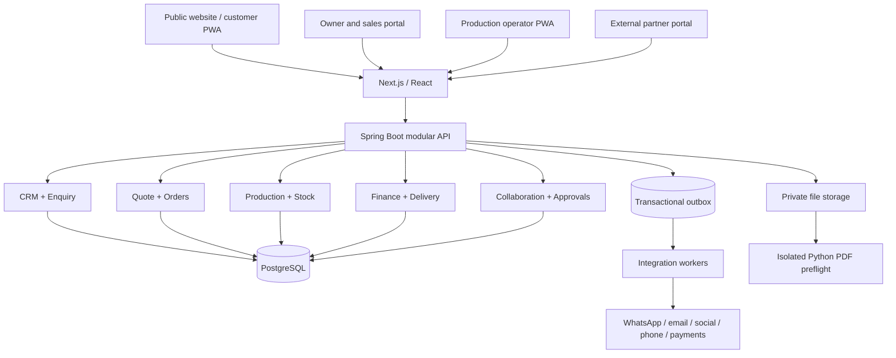
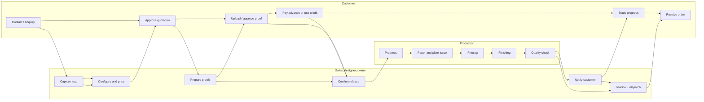
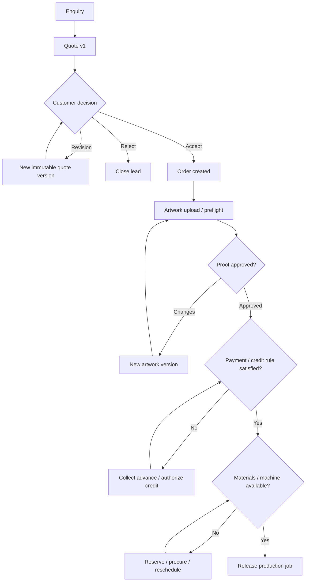
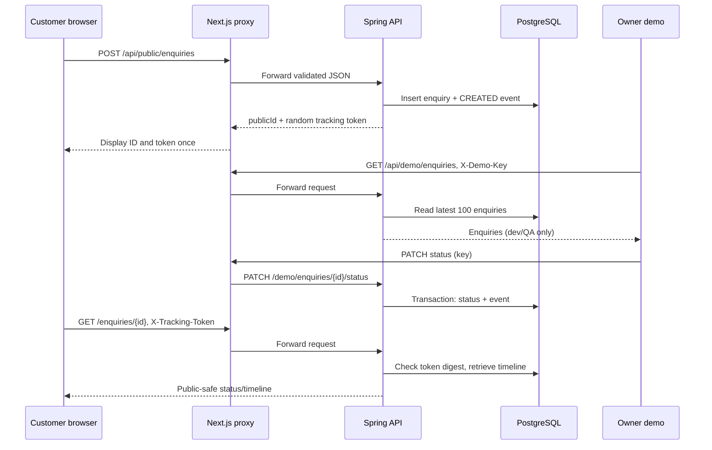
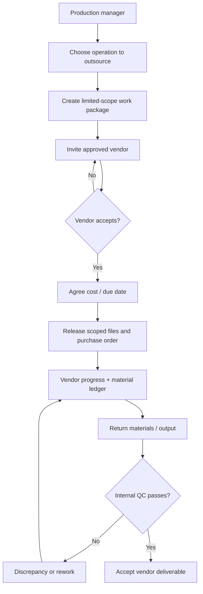
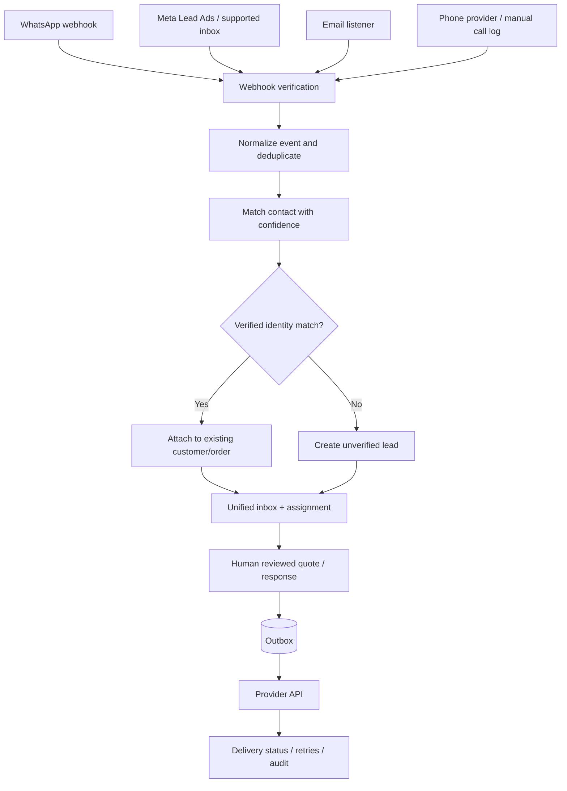
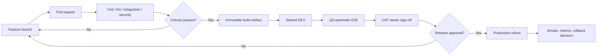
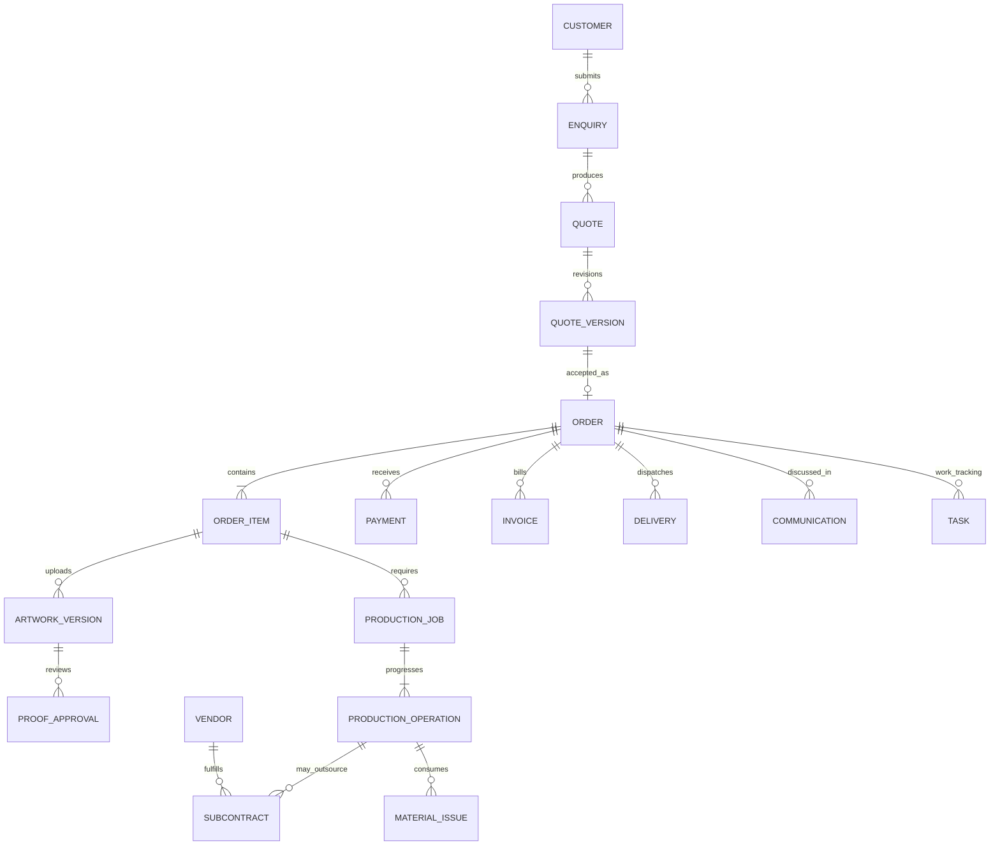
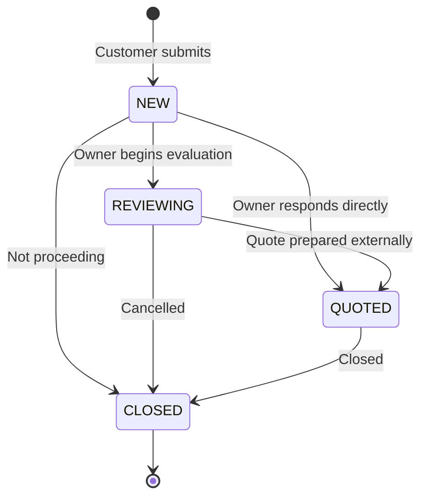

# PrintFlow architecture and workflow diagrams

All diagrams are **Mermaid**, editable in Markdown (GitHub/Codex, VS Code Mermaid preview). They show target state unless labelled Phase 0.

## 1. System architecture

## 2. Customer lifecycle and business swimlanes

## 3. Quote/proof order release rules

## 4. Phase 0 working API sequence

## 5. External outsourcing and work-sharing

## 6. Social and messaging integration

## 7. CI/CD and environments

## 8. Target ER relationships (high-level)

## 9. Phase 0 enquiry state machine

**Phase 0 note:** `QUOTED` is manually set; the real quote module does not exist until Phase 2. The frontend and backend are deliberate thin slices rather than claims of production functionality.
