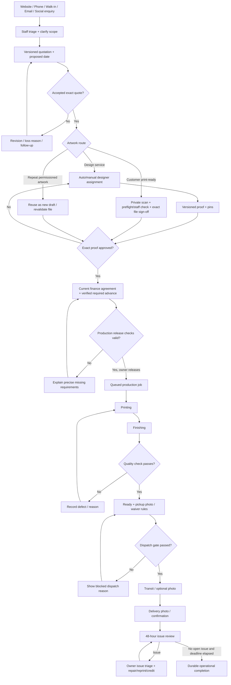
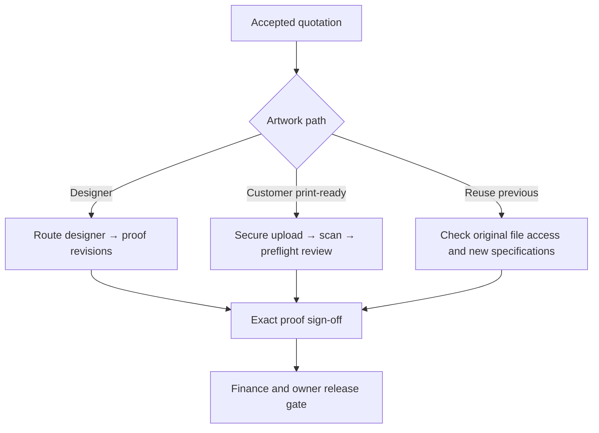
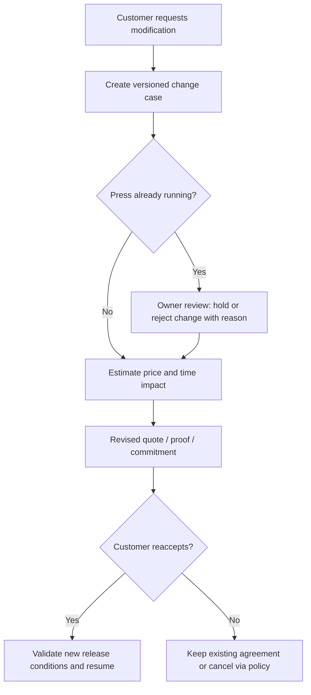
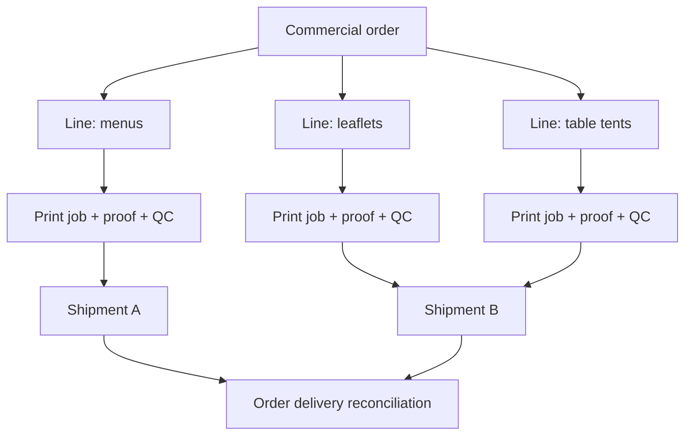
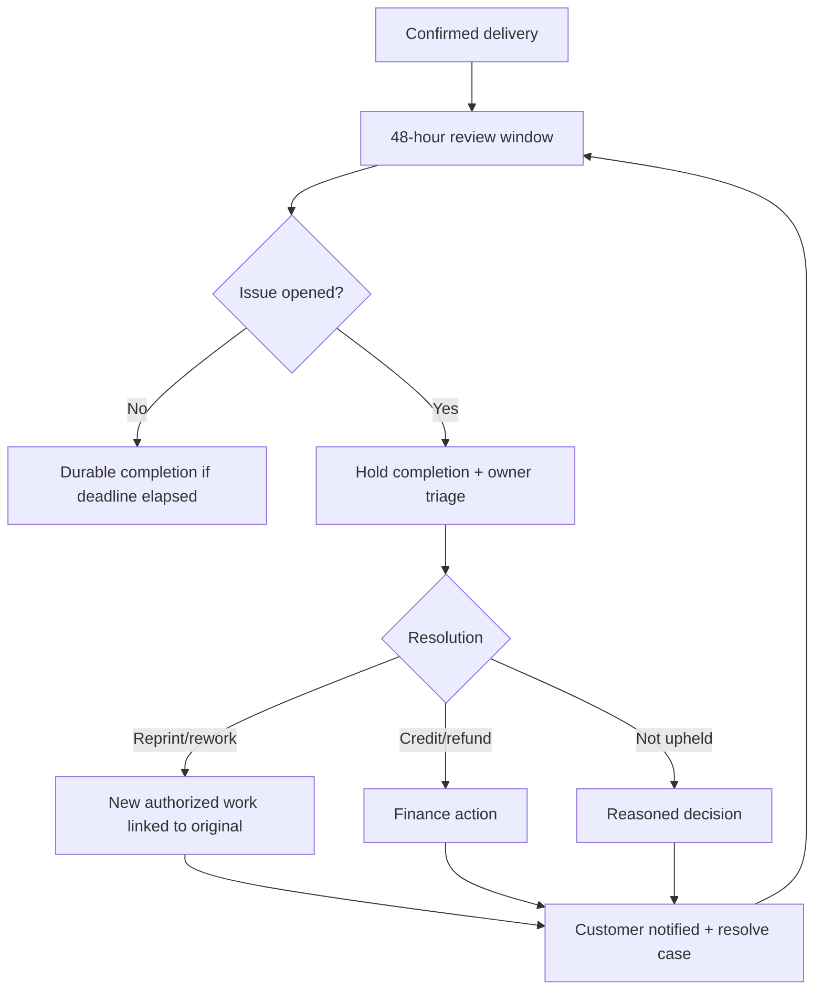

# J.D.Printex — Workflow Redesign, New Flow Architecture & Codex Execution Plan

**Date:** 24 October 2026
**Baseline:** `usuanhthja279/printflow`, branch `feature/printing-platform`, inspected commit `bc20f99b4c3a9c6c56606be988d4331247e6b049`
**Brand:** **J.D.Printex**, not HDPrintX. Prior HDPrintX boards are visual inspiration only.
**Evidence:** `J-D-Printex-Operations-Views.zip` (40 recorded views), `docs.zip`, and selected frontend components in GitHub.
**Status:** UX specification and clickable **demo-only** prototype; no changes have been pushed to the repository and no actual customer/payment/production actions were executed.

## 0. Executive direction

Do **not** replace J.D.Printex's workflow with a generic e-commerce checkout. The current product has real, high-value safeguards: staff MFA and per-record scopes, versioned quotes, native-scanned artwork, pin comments, exact proof approval, automatically routed designers, finance/advance gates, owner-controlled print release, printer-scoped production states and holds, QC rework, scanning and private delivery photo evidence, durable 48-hour post-delivery completion, and outbound email audit. Preserve them.

The redesign principle is **one next action per role, one authoritative record per project, explicit blocking prerequisites**. Make the visual storytelling premium on public pages; keep business surfaces precise and efficient. Never fabricate product pricing, live machine status, photos, reviews, actual payments, active stock, revenue, courier position, or provider connectivity.

### Findings grounded in actual screens

1. **Owner views are horizontally dense and repetitive** (`01`, `17`, `40`). Replace repeated large enquiry heading with module-specific page headers. Show an actionable exceptions inbox: awaiting customer, unassigned designer, deadline at risk, payment unverified, production hold, QC rejected, dispatch missing evidence. Prioritize by age and urgency, not decorative totals.
2. **Customer live-work view is long** (`10`, `39`), with a useful persistent conversation right rail. Introduce a prominent "Next action" card, stage overview, collapsible history, shortcut tabs, and a sticky conversation layout. Do not hide important proofs or payments in endless accordion sequences.
3. **Designer workspace is cramped inside a dialog** (`11`), while pinned proof feedback (`12`) has a separate customer + conversation context. Provide a full-width proof studio with page navigator, center canvas, and comments/version history rail; preserve existing exact-revision acknowledgements and hash checks.
4. **Payment agreement screens are dialog-heavy** (`14`, `15`). Show a clear financial summary plus release readiness gates, labeling test mode and manually verified receipts accurately. Separate customer action from owner reconciliation.
5. **Production controls live inside modals** (`17`–`26`). A compact Kanban queue should open a persistent job detail drawer / full screen, with controls selected from only legally available backend actions. HOLD/RESUME must preserve the previous production stage, reason and revision.
6. **Delivery action and evidence are separated** (`29`–`33`). Combine photo capture, server scanning status, evidence review, confirmation acknowledgement and the final milestone action in one stepper. Do not enable dispatch from selecting a local file: wait for the backend to confirm clean evidence.
7. **Photo gallery functionality is valuable** (`34`–`36`). Keep full-original preview; reduce thumbnail cropping and show stage, uploader and server upload time. Do not assert capture geolocation/time.
8. **Mobile printer queue exists** (`37`), but long horizontal lanes are cumbersome. Replace with a selected lane dropdown + full-width task cards, while desktop retains lanes.

## 1. Proposed journey and system boundaries

**Important:** Today, print-ready bypass, reorders, order-line job routing, stock reservations, partial dispatch, approved vendor sharing and more advanced complaint handling are **proposed additions**, not verified as implemented. The demo visualizes them but does not record events.

### Responsibility handoffs

| Transition | Responsible actor | Customer-facing language | Gate to enforce |
|---|---|---|---|
| Enquiry -> estimate | Sales/owner | Reviewing requirements | Valid enquiry, customer identifier, required details or advice request |
| Quote -> accepted | Customer or authorized offline-evidence recorder | Quote confirmed | Exact version, agreement provenance, price and date |
| Accepted -> design | Owner auto-routing/manual + designer | Designing your artwork | Available enabled designer; protected assignment and test-pool rules |
| Proof -> approved | Customer or duly-authorized evidenced offline approval | Artwork approved | Exact clean file, full-document acknowledgement, specific revision/hash |
| Approved -> press | Owner + accounts | Preparing to print | Accepted quotation + latest exact approved proof + current finance policy + verified required advance |
| Printing -> finishing | Assigned printer | Printing underway / finishing | Optimistic revision, stage, authorization, explicit confirmation |
| QC rejected -> rework | Authorized production operator | Additional quality checks | Record defect/rework reason, maintain evidence, do not claim completed |
| QC passed -> dispatch | Owner/delivery | Ready to deliver | Fulfillment stage, allowed balance/credit, invoice policy, clean pickup photo or valid owner exception |
| Transit -> delivered | Delivery staff/owner | Delivered | Clean delivery evidence where required, acknowledgement, authorized actor |
| Delivered -> complete | Scheduled backend transition | Completed | 48h since confirmed delivery, no open issue/hold; independent of payment settlement |

## 2. Customer UX: page-by-page

### 2.1 Public studio & service catalogue — existing, visual enhancement P0
- Preserve J.D.Printex name, configured enabled product families, and `?product=CODE` preselection in quote form.
- Premium editorial homepage with real work only if consented; clearly labeled illustrative print samples otherwise.
- Sticky "Request quote" and "Track enquiry" actions; accessible keyboard navigation and reduced-motion fallback.
- No fake starting prices, machine counts, testimonials, environmental claims or projected completion dates.

### 2.2 Guided quote request — existing, UX improvement P0
- Four steps: Product → Specifications → Artwork/assistance → Review.
- Guided/pro mode remains available, unknown sizes/GSM remain truly unknown.
- Persistent right-hand summary (product, quantity, deadline request, missing details), collapsible advice, autosaved local draft only if privacy constraints are met.
- Do not submit twice when a separate artwork upload fails; use the persisted enquiry reference and retry attachment only.

### 2.3 Customer project hub — existing, UX improvement P0
- Header: product + public reference + requested/agreed date, not decorative percentages.
- "What's next?" CTA, responsible party, due date / status, then Quotation → Design → Payment → Production → Delivery stepper.
- Large main working area plus anchored right-hand project conversation; mobile conversation moves below action panel.
- Summary of only customer-visible events. Show current status, estimates/confirmed times distinctly, approved quote/proof versions, balance and evidence gallery.
- Allow status request with an existing cooldown/one-open-request rule; do not assume operator can take calls.

### 2.4 Proof review studio — existing, high-priority P0
- Full-page 3-column desktop UI: thumbnails/page navigation (left), PDF/image canvas (center), current revision/pins/comments/approve panel (right).
- Previous revisions are visibly immutable, current revision unmistakable.
- Fit entire image without misleading cropping; pinch/zoom/accessibility supported.
- Approval requires existing server-side page acknowledgement, revision/hash validation, clean file, ownership. File not "approved" based on local UI action alone.
- If request changes: comments/pins saved as immutable review record; designer sees it immediately within authorized workspace.

### 2.5 Finance & order details — existing, P0
- Distinguish agreed amount, verified advance, balance, invoice, production release gate and dispatch gate.
- Manual receipts labelled verified/unverified; Razorpay TEST clearly displayed; never show real collection without provider event.
- Customer sees payment actions only if permitted and configured; staff sees verification/reversal actions only per role.

### 2.6 Tracking and delivery evidence — existing, P0
- Customer sees simple milestone timeline with staff-confirmed operations, not GPS/live machine claims.
- Private gallery with pickup/transit/delivery stages, preview-original, captions, server-upload time, scan-clean status.
- After delivered: open review/issue hold and 48-hour countdown only if derived from server deadline. No browser-side completion decision.

## 3. Owner, specialist and field UX

### 3.1 Owner action centre — P0 design improvement
- Replace repeated enquiry header with contextual modules and a prioritized exception queue.
- Summary cards must reflect actual scoped data only. Avoid displaying synthetic revenue / production KPIs.
- "Needs action" list: unassigned designer, returned proof, missing advance, pending release, held press, failed QC, evidence scan pending, overdue confirmation.
- Drill-down enters selected existing workspace preserving scroll/filter where safe.

### 3.2 Designer routing — P0
- Availability and workload cards from existing `/api/v1/owner/design-routing` endpoint. Show AUTO/MANUAL assignment modes and TEST/BUSINESS pools only to authorized owner.
- Explain workload as active design-stage projects (not estimated machine hours).
- Existing manual "unassign" mode and auto-resume semantics must not change silently.

### 3.3 Printer / owner production — P0
- Desktop: small fixed-height Kanban columns WAITING_RELEASE, QUEUED, PRINTING, FINISHING, QC, READY. HOLD overlay is a state flag, not a seventh linear stage.
- Mobile: lane selector plus vertical cards, simple "My jobs" queue.
- Job detail drawer uses `GET/POST /api/v1/production/enquiries/{id}`, optimistic revision + `confirmed:true`; owner assignment, machine label (not reservation), priority and due date. Never drag-drop to bypass confirmation/revision/gates.
- Each transition has reason/notes and explicit next state, with separate private note / customer-visible update.

### 3.4 Delivery stepper — P0
- Step 1: Pickup photo; upload to private storage; show pending / clean / rejected; provide rescan action for authorized staff.
- Step 2: Show invoice, settlement/approved credit, QC and clean pickup evidence / explicit owner waiver in one readiness panel.
- Step 3: Confirm dispatch, optional transit stage photo, and delivery evidence before final confirmation.
- Explicitly label server upload timestamps; transit pictures optional. No unverified GPS claims.

## 4. New/additional flows — not to be conflated with existing implementation

| Flow | Priority | What changes | Critical guard |
|---|---|---|---|
| **A. Print-ready artwork route** | P1 | Customer can supply final print file, with no normal designer work if prepress confirms readiness | Scan + staff check + exact file approval still mandatory; no auto release |
| **B. Repeat-order draft** | P1 | Copy permitted specs/artwork from past job into new enquiry | Never reuse prior price, customer signature or delivery commitment |
| **C. Change request after acceptance** | P1 | Quantity/stock/finish/artwork/date change case, staff impact review and revision | Preserve old quote/proof, price/schedule impact, reapproval, press-stage exception |
| **D. Multi-line commercial order** | P1/P2 | One order with menus + leaflets + packaging as separate production jobs | Per-line proof, quantity, inventory, QC and dispatch allocation |
| **E. Inventory readiness** | P1/P2 | Reserve/issue/return paper and consumables, raise shortage block | Stock movements transactional; machine label is not capacity commitment |
| **F. External partner handoff** | P2 | Limited partner invite to lamination/finishing or overflow job | Whitelisted files, private expiry, no customer prices or unrelated jobs |
| **G. Partial/multiple deliveries** | P2 | Split ready quantities and dispatch by shipment | No negative balances, reconcile delivered quantities and evidence |
| **H. Post-delivery service case** | P1 | Claim/reprint/corrective action/credit requests with evidence and owner resolution | Suspend 48h completion while issue open; maintain immutable history |
| **I. Incoming email conversation** | P2 | Thread-safe Gmail inbound sync, triage unmapped messages | Email subject alone is not proof of customer identity; scan attachments |
| **J. WhatsApp channel** | P2 | Consent-based official messaging and status messages | Approved templates, opt-in, verified channel, durable outbox retries |
| **K. Campaign/portfolio consent** | P2 | Publish permitted completed work and track referred leads | Separate customer authorization; no private proof publication |
| **L. Machine capacity and costing** | P2 | Real press eligibility, schedule and margin calculations | No predicted dates presented as confirmed commitments |

### Flow A — Artwork-path decision

### Flow B — Customer-requested amendment

### Flow C — Split item and shipment

### Flow D — Complaint and completion hold

## 5. Component-level implementation map (existing repo)

The current Next.js routes mostly import large components. First refactor *inside those components*; do not change API contracts or authentication just for aesthetics.

| Existing file | Redesign task | Backend boundary |
|---|---|---|
| `frontend/src/components/PrintStudio.tsx` | Editorial hero, valid catalogue/finish mockups | Only actual published products |
| `frontend/src/components/ProductDetail.tsx` | Accessible product gallery and selected-spec summary | Configured product options |
| `frontend/src/app/request-quote/page.tsx` + quote components | Guide/pro mode, 4-step summary, attachment retries | Existing enquiry and file APIs |
| `frontend/src/components/LiveWork.tsx` | Next action hero, compact stage nav, conversational side rail | GET `/v1/design/enquiries/{id}/work` |
| `frontend/src/components/DesignProofs.tsx`, `ProofPdf.tsx`, `ProofImage.tsx` | Full-width proof workspace, page rail, pinned thread | Revision/hash/page acknowledgements unchanged |
| `frontend/src/components/StaffWorkspace.tsx` + `IntakeQueue.tsx` | Module-centric navigation and action centre | Owner/staff auth, CSRF, MFA unchanged |
| `frontend/src/components/DesignerRoutingPanel.tsx` | Availability, assignment provenance and workload | `/v1/owner/design-routing` |
| `frontend/src/components/ProductionBoard.tsx`, `ProductionJobPanel.tsx` | Kanban/drawer plus lane select on mobile | `/v1/production/queue` + operation API |
| `frontend/src/components/PaymentsPanel.tsx` | Finance summary and visible release blocker list | Keep paise ledger / Razorpay mode / webhook semantics |
| `frontend/src/components/FulfilmentPanel.tsx`, `DeliveryPhotoPanel.tsx` | Evidence-first pickup/transit/delivery stepper | Keep private SHA checks / scan state / stage gates |
| `frontend/src/components/WorkConversation.tsx`, `MailActivity.tsx` | Unified communication timeline with channel labels | Inbound mail remains unconnected until built |

**Repository root note:** The application currently sits under `printflow application/`. Its documented native Windows DEV is Java 21 + Gradle wrapper + PostgreSQL + Next.js, **not Docker**. Do not introduce containerization as a prerequisite for these UX changes. The Cloudflare tunnel setup is separate.

## 6. Proposed UI design system

- Identity: **J.D.Printex** everywhere, never previous visual-reference brand.
- Main colours: deep ink/navy `#0B2233`, navy surface `#143246`, electric-blue interactive `#3466E9`, warm-paper `#F7F3EE`, soft-peach highlight `#F2BEA6`, white `#FFFFFF`; red and amber reserved for real operational states.
- Typography: bold compact system sans for control surfaces, optional editorial serif for *public marketing only*; avoid importing unlicensed font files.
- State vocabulary: Action needed / Waiting for customer / Waiting for business / In progress / On hold / Complete; distinguish workflow state from payment state.
- Motion: 150–250 ms for hover/state change; avoid perpetual dashboard motion, scroll hijacking, or motion-essential controls.
- Responsive: customer 360px; printer/delivery phone-first; desktop proof studio at 1280px+; mobile proof PDF pages and comments remain fully accessible.
- Accessibility: visible focus, forms with labels, status text not colour alone, accessible dialogs, actual button disabling on server-invalid actions, `prefers-reduced-motion`.
- Events: show **source and confidence** (Staff confirmed, Customer approved, Payment verified, Provider delivered, Upload scanned), not unqualified "live".

## 7. UX implementation batches and acceptance gates

### Batch 1 — UX foundation and current-flow redesign (P0)
- Audit all visible components and existing screenshot tests.
- Add shared token CSS/components for `NextAction`, `ReadinessChecklist`, `ProjectStageStepper`, `EntityActivity`, `EvidenceUploadStatus`, `ProductionJobCard` and `RoleActionBar`.
- Refactor `LiveWork`, `StaffWorkspace`, `DesignProofs`, `ProductionBoard`, `FulfilmentPanel` and `DeliveryPhotoPanel` presentation only.
- Keep every existing network mutation and server enforcement unchanged.
- Test desktop + 390px phone: long PDF, quotation versions, proof approval, production HOLD/RESUME, failed scan and delivery gallery.

### Batch 2 — Clarity and exception workflows (P0/P1)
- Server-derived next-action/readiness projection or compute safely from existing authorized DTOs without guessing missing fields.
- Customer change-case UI with statuses **only after** versioned backend entity exists.
- Workflow inbox for unresolved customer requests and post-delivery issues, honoring the durable completion hold.
- Distinguish current backend support from roadmap concepts in UI and route availability.

### Batch 3 — Additional paths (P1)
- Print-ready path with staff preflight review and permissioned prior-art reuse.
- Reorder as a new enquiry draft, no implicit acceptance.
- Owner risk queue derived from actual events and agreements.
- Add backend/API/security tests before exposing the paths publicly.

### Batch 4 — Deep printing operations (P1/P2)
- Order-line job routing, stock reservations, QC checklist and job-ticket PDFs.
- Partial/multiple shipment reconciliation with scanned stage evidence.
- Machine capacity and vendor work sharing only after authorization + inventory correctness.

### Batch 5 — Connected operations (P2)
- Official Gmail inbound sync, WhatsApp opt-in and template handling, settlement reconciliation, consent-controlled portfolio, repeat-order prompts.
- Do not badge these as operational until production-provider verification succeeds.

### Minimum quality acceptance tests
1. No role receives pricing/contact/artwork not authorized under existing resource scopes.
2. No "Approve" enabled unless exact current clean proof and full-document acknowledgment are valid.
3. No double enquiry submitted if artwork upload is retried.
4. Designer auto/manual override and test-pool isolation stay intact.
5. Production stage transition always includes optimistic revision and explicit confirmation; hold/resume preserves stage and reason.
6. QC rejection creates proper rework; no bypass to READY.
7. Dispatch blocked without required clean pickup evidence or authorized waiver and finance conditions.
8. Delivery confirmation blocked without required clean delivery photo.
9. Source files and evidence are private, immutable where documented, never publicly linked; scan failures never show as "Ready".
10. Customer progress and finance balances use actual authorized backend response; no fake live status.
11. Phone layout has no horizontal body overflow; lane/table scrolling intentionally contained.
12. Recovery from failed upload, API timeout, stale revision and network reconnect is clear and non-destructive.
13. The 48-hour completion worker is not replaced with a browser timer.
14. Production deployment not attempted as part of a UI-design task.

## 8. Codex prompt — copy verbatim

> Work in repository `usuanhthja279/printflow`, branch `feature/printing-platform`, under `printflow application/`. The official product name is J.D.Printex. Read `AGENTS.md`, `docs/OPERATIONS_WORKFLOW.md`, `docs/UI_EXPERIENCE_REDESIGN.md`, `docs/REMAINING_FEATURES.md`, `docs/PAYMENTS_AND_INVOICES.md`, and this redesign specification before editing. Preserve all existing approvals, role scoping, MFA, native file scanning, payment verification, outbox/notification boundaries, immutable proofs, production revision gates, QC rework, delivery evidence and scheduled 48-hour completion.
>
> First audit the current UI and produce an implementation map keyed to the existing components. Then implement **Batch 1 only** on a new feature branch. Replace long dialogs and dense repeated sections with reusable action-oriented components, particularly customer next action + project overview, designer proof studio, owner exceptions, compact production jobs, and evidence-first delivery. Reuse the existing endpoints; do not invent backend data, actual prices, connected messaging, inventory or new statuses. All UI transitions must remain server-authoritative.
>
> Do not rebuild the application, migrate Next.js, add a new state library or Docker as a prerequisite. Maintain existing API contracts and security. Add Playwright interaction and responsive tests, accessibility checks and focused Java/Gradle regression cases where UI interacts with state boundaries. Ensure stale revisions, failed scans and unpaid orders visibly block actions. Report exact files changed, tests run, limitations, and representative screenshots. Do not deploy to production or enable real providers. After Batch 1, **stop** and present the results before moving to new backend flows.

## 9. Artifacts in accompanying pack

- `JD_Printex_Workflow_Redesign_v2.html`: navigation through 16 design views (existing workflow and clearly labeled future screens); all interactions in this prototype are local simulations.
- `JD_Printex_Design_Overview.png`: concept illustration, not current production screenshot.
- `current-workflow-contact.jpg`: montage of user-provided recorded app screenshots for visual comparison.
- This Markdown plan.

### Validation scope

The content of the HTML demo was inspected and parsed, but a complete interactive browser test may be unavailable in the artifact-building environment. **This pack is a design handoff, not a verified frontend build or a GitHub PR.** Code-level integration still needs Codex verification against the branch head before changes are merged.
